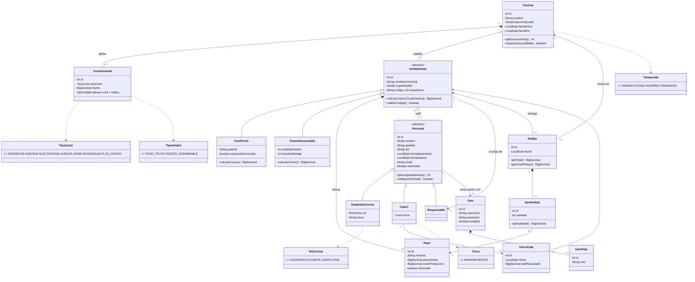
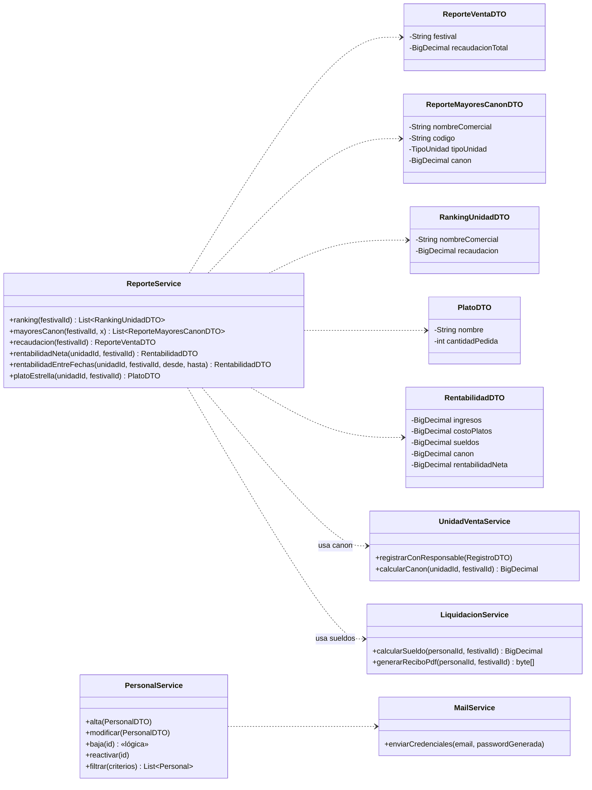

# Diagrama de clases - Epicentro Gourmet (borrador)

Se renderiza directo en GitHub (Mermaid).

## 1. Dominio (entidades persistentes)

## 2. DTOs de reporte (no persisten) y servicios

## Decisiones de diseño

- `Personal` es la raíz de la herencia (JOINED, igual que `Person` en el repo de ejemplo). `Responsable` es un `Personal`, porque el enunciado dice que es "uno de los miembros del Staff".
- Los montos (sueldo base, $500/m², plus de antigüedad, plus de cocina) **no se hardcodean**: viven en `CostoFestival` y se leen desde ahí.
- La baja lógica es el campo `eliminado` en `Personal` y `Plato`.
- Los DTOs de reporte no son entidades: se arman en `ReporteService` a partir de consultas.
